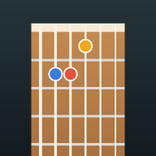

<p align="center">
  
</p>

<h1 align="center">GuitarSeo</h1>

<p align="center">
  App personal para practicar <strong>teoría musical aplicada a la guitarra</strong>.<br>
  Funciona en el iPhone como una app más (pantalla de inicio, pantalla completa y sin conexión) y también en el PC.
</p>

<p align="center">
  <a href="https://asier-merino.github.io/MyGuitarApp/"><strong>▶ Abrir la app</strong></a>
  &nbsp;·&nbsp;
  <a href="BUILD_PLAN.md">Plan de construcción</a>
  &nbsp;·&nbsp;
  <a href="#estado-del-proyecto">Estado</a>
</p>

---

## ¿Qué es?

Una app para aprender y practicar teoría **con la guitarra en mente**. Funciona como el menú de un juego: cada pantalla tiene un solo propósito y desde el **Inicio** se llega a todo.

| | **TEORÍA** | **PRÁCTICA** | **AFINACIONES** | **GLOSARIO** |
|---|---|---|---|---|
| **Cuándo** | Sin guitarra (en el sofá, en el metro…) | Con la guitarra en las manos | Antes de tocar | Cuando tengas una duda |
| **Qué hay** | Lecciones cortas por tarjetas, consulta y ejercicios tipo quiz | Texto grande, avance automático, voz, metrónomo y bases | Las 7 afinaciones de la app, que suenan al tocarlas | Todos los conceptos, con buscador en español y en inglés |

Además, desde el Inicio:

- **Perfil**: racha, días practicados, tiempo total, dominio por tema, mapa del mástil, puntos débiles y récords.
- **Ajustes**: notación, tema, mástil, sonido y voz, afinación por defecto y copia de tus datos.

Algunas ideas clave:

- **Navegación libre**: todo está siempre disponible, sin un orden obligatorio. Cada pantalla tiene una flecha **←** para volver.
- **Ejercicios generados al azar**, con **3 niveles** (Básico, Intermedio y Avanzado). La app repite más lo que más fallas.
- **Ayuda en todos los ejercicios**: el botón **?** recuerda cómo se juega y la teoría que hay detrás, y al fallar, **¿Por qué?** explica el error concreto.
- **Sin sonido automático**: al responder aparece un botón de altavoz para escuchar la respuesta correcta cuando quieras.
- **Práctica sin autoevaluación**: al terminar ves qué has hecho y tus récords; tú ya sabes cómo te ha ido.
- **Doble notación**: la principal en grande y la otra en pequeño, por ejemplo **Fa** <sub>F</sub> o **F** <sub>Fa</sub>. Se elige en **Ajustes**.
- **Colores con significado**: la fundamental, la 3ª, la 5ª, la 7ª y la *blue note* tienen siempre el mismo color, y cada punto lleva además su etiqueta.
- **Tema oscuro por defecto**, con tema claro o automático en Ajustes.
- **Todo se guarda solo**, en tu dispositivo.

> Esta es la descripción de la app terminada. Se construye por fases: lo que ya funciona está en [Estado del proyecto](#estado-del-proyecto).

---

## Instalarla en el iPhone

1. Abre **https://asier-merino.github.io/MyGuitarApp/** en **Safari**. Tiene que ser Safari.
2. Pulsa **Compartir** (el cuadrado con la flecha hacia arriba).
3. Elige **«Añadir a pantalla de inicio»** y pulsa **Añadir**.
4. Ábrela siempre desde el icono: se verá a pantalla completa y funcionará sin conexión.

> **Importante:** tus datos se guardan **solo en ese dispositivo**, y el iPhone guarda los de la app instalada **aparte** de los de Safari. Usa siempre el icono y, de vez en cuando, haz una copia desde **Ajustes → Exportar copia**. Con esa copia también puedes pasar tus datos a otro dispositivo (**Importar copia**).

**Actualizaciones:** cuando hay una versión nueva, aparece un aviso con el botón **Actualizar**. También puedes ir a **Ajustes → Buscar actualización**. La versión que tienes cargada se ve en **Ajustes**.

---

## Módulos

| # | Módulo | Teoría (sin guitarra) | Práctica (con guitarra) |
|---|---|---|---|
| 1 | **Notas del mástil** | «¿Qué nota es?», encuéntrala, octavas, unísonos, rellena el mástil | La app dice una nota y la tocas en todas las cuerdas a contrarreloj |
| 2 | **Acordes abiertos** | Diagramas, notas que los forman, quiz | Cambios de acordes con metrónomo, tus propias progresiones y rasgueo |
| 3 | **Oído** | ¿Mayor o menor?, intervalos | Suena una nota y la buscas en la guitarra |
| 4 | **Escala y tonalidad** | Intervalos, escala mayor, grados, quiz | Escala con metrónomo y progresiones |
| 5 | **Blues y slide** | 12 compases, *blue note*, quiz | Base shuffle, notas objetivo, licks pregunta-respuesta |
| 6 | **CAGED** | Explorador de las 5 formas, quiz | Un acorde en una forma, recorrer las 5 formas |
| 7 | **Calentamiento** | — | Un dedo por traste con tablatura y subida automática de tempo |

En las pantallas de Teoría y de Práctica hay también una **sesión mezclada** que combina ejercicios de varios módulos.

---

## Estado del proyecto

La app se construye **por fases**. Cada fase se prueba en el iPhone antes de empezar la siguiente.

| Fase | Contenido | Estado |
|---|---|---|
| 0 | Cimientos: estructura, ajustes, notación ES/EN, temas, PWA y publicación | ✅ Hecha (v0.0.0) |
| 1A | Navegación por pantallas, estilo GuitarSeo, Afinaciones, Glosario, Ajustes y nombre e icono nuevos | ✅ Hecha (v0.1.0) |
| 1B | Mástil, sonido, voz, metrónomo, motores de ejercicios, ayuda «?», esquemas del glosario y registro de sesiones | ⏳ Siguiente |
| 2 | Notas del mástil | Pendiente |
| 3 | Acordes abiertos y Calentamiento | Pendiente |
| 4 | Oído | Pendiente |
| 5 | Escala y tonalidad | Pendiente |
| 6 | Blues y slide | Pendiente |
| 7 | CAGED | Pendiente |
| 8 | Perfil completo y sesión mezclada | Pendiente |

### Qué funciona ya (v0.1.0)

- **Inicio** con Teoría, Práctica, Afinaciones y Glosario, y los iconos de Perfil y Ajustes.
- **Navegación** por pantallas con la flecha **←** (también si abres la app directamente en una pantalla interior) y el botón **?** de ayuda en cada una.
- **Afinaciones**: las 7 afinaciones agrupadas; cada nota suena al tocarla y **Tocar todas** recorre las cuerdas despacio para afinar de oído. Las cuerdas que cambian respecto a la estándar se marcan en ámbar con su flecha.
- **Glosario**: 15 conceptos de Notas y Afinaciones, con buscador en español y en inglés (sin importar tildes) y fichas con **Escuchar**. Las palabras subrayadas con puntos abren su ficha en un panel.
- **Ajustes** completos: notación, alteraciones, tema (oscuro por defecto, claro o automático), mástil, sonido, volumen, voz, afinación por defecto y copia de tus datos.
- **Perfil** provisional (días y tiempo aparecerán cuando lleguen los ejercicios) y **Acerca de**.
- Los módulos y sus ejercicios aparecen como **Próximamente**. En Notas del mástil ya se puede abrir la preparación de cada ejercicio (nivel y afinación se recuerdan), pero **Empezar** se activa en la Fase 2.

**Próximo cambio en el Glosario (Fase 1B):** cada ficha tendrá un **esquema visual** de lo que explica (un trozo de mástil, un diagrama de acorde o tablatura) que **suena al tocar sus puntos**. Por ejemplo, «Notas naturales» mostrará las 7 notas naturales en el mástil. Lo mismo vale para las tarjetas de las lecciones. Solo se queda sin esquema algún concepto en el que no tiene sentido, como «Nombres de las notas» (es una equivalencia de nombres, no un lugar del mástil).

Capturas de cada fase en [`docs/capturas/`](docs/capturas/).

El detalle de cada fase, con sus casillas y su registro de cambios, está en **[BUILD_PLAN.md](BUILD_PLAN.md)**.

---

## Para desarrollar

No hay frameworks ni nada que instalar para que la app funcione: es **HTML, CSS y JavaScript** normales. Solo hace falta [Node.js](https://nodejs.org/) para los tests.

### Abrirla en el ordenador

```bash
npx serve .
```

Después abre la dirección que aparece (normalmente http://localhost:3000). Si haces doble clic en `index.html` no funciona, porque hace falta un servidor.

> En `localhost` el modo sin conexión está desactivado a propósito, para ver siempre los últimos cambios.

### Tests

```bash
npm test
```

Comprueban toda la lógica musical (nombres de nota, escalas, afinaciones, octavas…), que los textos del glosario digan cosas ciertas y enlacen a conceptos que existen, que el sonido esté afinado, el guardado de datos y que la app tenga todos sus archivos para funcionar sin conexión.

### Otros comandos

| Comando | Para qué |
|---|---|
| `npm run icons` | Volver a generar el icono (`icons/icon.svg` y los PNG) |

### Publicar una versión nueva

Cada `push` a la rama `main` actualiza la app publicada en 1–2 minutos. Antes de subir cambios de la app:

1. `npm test` en verde.
2. Subir `CACHE_VERSION` en [`sw.js`](sw.js), para que los iPhone descarguen la versión nueva.
3. Subir `APP_VERSION` en [`js/version.js`](js/version.js) (`0.N.x` = fase N).

> El repositorio se sigue llamando `MyGuitarApp` a propósito: cambiarle el nombre cambiaría la dirección de la app y habría que volver a instalarla.

---

## Cómo está organizado

```
├── index.html               Página principal
├── manifest.webmanifest     Datos para instalarla como app
├── sw.js                    Funcionamiento sin conexión
├── css/styles.css           Estilos, colores y temas oscuro/claro
├── icons/                   Iconos de la app
├── js/
│   ├── main.js              Arranque: qué pantalla se pinta en cada dirección
│   ├── routes.js            Mapa de pantallas y adónde vuelve la flecha ←
│   ├── settings-view.js     Pantalla de ajustes
│   ├── screens/             Inicio, Teoría/Práctica, módulo y preparación
│   ├── core/                Lógica musical (notas, escalas, mástil…), sin interfaz
│   ├── data/                Datos: afinaciones, acordes, CAGED, cajas, licks, rasgueos y conceptos del glosario
│   ├── ui/                  Piezas de interfaz (doble notación, mástil, tablatura, ayuda «?»…)
│   ├── audio/               Sonido, metrónomo y bases
│   ├── engine/              Motores de los ejercicios de Teoría y Práctica
│   ├── modules/             Cada módulo, más Afinaciones, Glosario y Perfil
│   └── …                    Router, guardado de datos y ajustes
├── tests/                   Tests de la lógica musical, los datos y el guardado
└── tools/                   Utilidades (generador de iconos)
```

La carpeta `engine/` y parte de `data/`, `ui/`, `audio/` y `modules/` se crean en las próximas fases. Toda la teoría musical vive en `js/core/` y `js/data/`, separada de la interfaz, para poder comprobarla con tests.

---

## Documentos del proyecto

- **[BUILD_PLAN.md](BUILD_PLAN.md)**: el plan completo, con las fases, los datos musicales de referencia (afinaciones, acordes, CAGED, cajas pentatónicas, licks, rasgueos), el diseño de cada pantalla, las propuestas y el registro de cambios.
- **[CLAUDE.md](CLAUDE.md)**: las instrucciones y convenciones para Claude Code, que construye la app fase a fase.
